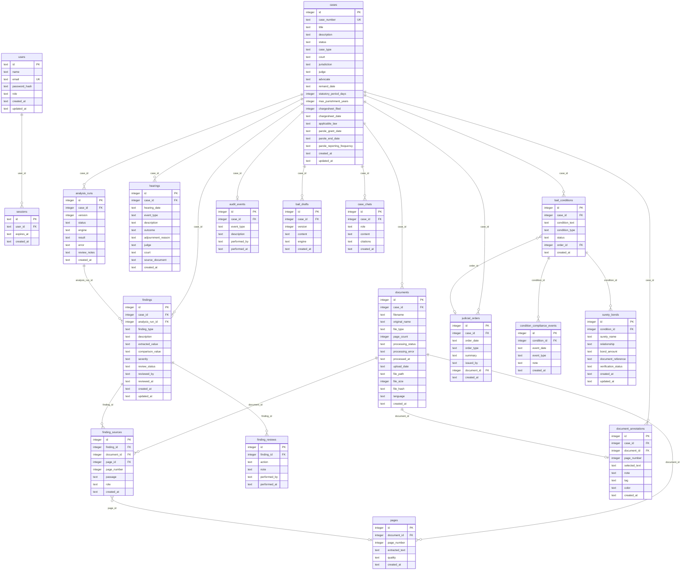

# Database Schema

NyayaTrace uses **SQLite** via `better-sqlite3` and **Drizzle ORM**. The database file is `nyayatrace.db` in the project root. The schema is defined in [`lib/db/schema.ts`](lib/db/schema.ts). Migrations are managed by `drizzle-kit` and stored in the `drizzle/` directory.

> **Never include real credentials, production data, or personal case information in this documentation.**

---

## Configuration

| Setting | Value |
|---|---|
| ORM | Drizzle ORM (`drizzle-orm`) |
| Driver | `better-sqlite3` |
| Database file | `nyayatrace.db` |
| Dialect | SQLite |
| Migration output | `drizzle/` |
| Schema source | `lib/db/schema.ts` |

See [`drizzle.config.ts`](drizzle.config.ts) for the Drizzle Kit configuration.

---

## ER Diagram



---

## Tables

### `users`

Registered users of the application.

| Column | Type | Constraints | Description |
|---|---|---|---|
| `id` | TEXT | PK | UUID-style random hex string |
| `name` | TEXT | NOT NULL | Display name |
| `email` | TEXT | NOT NULL, UNIQUE | Login email (lowercase) |
| `password_hash` | TEXT | NOT NULL | bcrypt hash (10 rounds) |
| `role` | TEXT | NOT NULL, DEFAULT `'advocate'` | `advocate`, `clerk`, or `admin` |
| `created_at` | TEXT | DEFAULT now | ISO datetime |
| `updated_at` | TEXT | DEFAULT now | ISO datetime |

**Indexes:** `users_email_idx` (unique)

---

### `sessions`

Active authentication sessions.

| Column | Type | Constraints | Description |
|---|---|---|---|
| `id` | TEXT | PK | Random hex token (session cookie value) |
| `user_id` | TEXT | NOT NULL, FK → users.id (CASCADE) | Owner |
| `expires_at` | TEXT | NOT NULL | ISO datetime; 7-day expiry from creation |
| `created_at` | TEXT | DEFAULT now | ISO datetime |

**Indexes:** `sessions_user_id_idx`, `sessions_expires_at_idx`

---

### `cases`

Core case records.

| Column | Type | Constraints | Description |
|---|---|---|---|
| `id` | INTEGER | PK, autoincrement | Internal ID |
| `case_number` | TEXT | NOT NULL, UNIQUE | Official case reference (or `NT-<uuid>` if not provided) |
| `title` | TEXT | NOT NULL | Case title |
| `description` | TEXT | — | Free-text case notes |
| `status` | TEXT | NOT NULL, DEFAULT `'unspecified'` | `active`, `closed`, `pending`, `stayed`, `unspecified` |
| `case_type` | TEXT | NOT NULL | `criminal`, `civil`, `bail`, `parole`, `unspecified` |
| `court` | TEXT | — | Court name |
| `jurisdiction` | TEXT | — | Jurisdiction |
| `judge` | TEXT | — | Presiding judge |
| `advocate` | TEXT | DEFAULT `'Aditi Sharma'` | Assigned advocate |
| `remand_date` | TEXT | — | Date of first remand (ISO) |
| `statutory_period_days` | INTEGER | DEFAULT `60` | 60 or 90 days for statutory bail |
| `max_punishment_years` | INTEGER | — | Max sentence for the offence |
| `chargesheet_filed` | INTEGER | DEFAULT `0` | Boolean (0/1) |
| `chargesheet_date` | TEXT | — | Date chargesheet was filed |
| `applicable_law` | TEXT | DEFAULT `'auto'` | `crpc`, `bnss`, or `auto` (inferred from remand date) |
| `parole_grant_date` | TEXT | — | Parole grant date |
| `parole_end_date` | TEXT | — | Parole end date |
| `parole_reporting_frequency` | TEXT | — | `weekly`, `fortnightly`, `monthly` |
| `created_at` | TEXT | DEFAULT now | ISO datetime |
| `updated_at` | TEXT | DEFAULT now | ISO datetime |

**Indexes:** `cases_case_number_idx`, `cases_status_idx`

---

### `documents`

Uploaded documents per case.

| Column | Type | Constraints | Description |
|---|---|---|---|
| `id` | INTEGER | PK, autoincrement | Internal ID |
| `case_id` | INTEGER | NOT NULL, FK → cases.id (CASCADE) | Owning case |
| `filename` | TEXT | NOT NULL | UUID-based filename on disk |
| `original_name` | TEXT | NOT NULL | Original filename from upload |
| `file_type` | TEXT | NOT NULL | `pdf`, `image`, `scan` |
| `page_count` | INTEGER | DEFAULT `0` | Number of processed pages |
| `processing_status` | TEXT | NOT NULL, DEFAULT `'pending'` | `pending`, `processing`, `complete`, `failed` |
| `processing_error` | TEXT | — | Error message if status is `failed` |
| `processed_at` | TEXT | — | ISO datetime of completion |
| `upload_date` | TEXT | DEFAULT now | ISO datetime |
| `file_path` | TEXT | — | Relative path under `uploads/` |
| `file_size` | INTEGER | NOT NULL, DEFAULT `0` | Bytes |
| `file_hash` | TEXT | — | SHA-256 hex digest (deduplication) |
| `language` | TEXT | DEFAULT `'eng'` | Tesseract OCR language code |
| `created_at` | TEXT | DEFAULT now | ISO datetime |

**Indexes:** `documents_case_id_idx`, `documents_case_hash_idx` (unique on `case_id + file_hash`)

---

### `pages`

Extracted text per document page.

| Column | Type | Constraints | Description |
|---|---|---|---|
| `id` | INTEGER | PK, autoincrement | Internal ID |
| `document_id` | INTEGER | NOT NULL, FK → documents.id (CASCADE) | Owning document |
| `page_number` | INTEGER | NOT NULL | 1-based page number |
| `extracted_text` | TEXT | — | OCR or embedded text |
| `quality` | TEXT | NOT NULL, DEFAULT `'good'` | `good`, `poor`, `unreadable` |
| `created_at` | TEXT | DEFAULT now | ISO datetime |

**Indexes:** `pages_document_id_idx`

---

### `analysis_runs`

Versioned analysis run records per case.

| Column | Type | Constraints | Description |
|---|---|---|---|
| `id` | INTEGER | PK, autoincrement | Internal ID |
| `case_id` | INTEGER | NOT NULL, FK → cases.id (CASCADE) | Owning case |
| `version` | INTEGER | NOT NULL | Auto-incrementing version per case |
| `status` | TEXT | NOT NULL | `running`, `complete`, `failed` |
| `engine` | TEXT | NOT NULL | Provider string, e.g. `gemini:gemini-2.5-flash[lang:English]` |
| `result` | TEXT | — | JSON-serialized synopsis |
| `error` | TEXT | — | Error message if status is `failed` |
| `review_notes` | TEXT | NOT NULL, DEFAULT `''` | Advocate review notes |
| `created_at` | TEXT | DEFAULT now | ISO datetime |

**Indexes:** `analysis_runs_case_id_idx`, `analysis_runs_case_version_idx` (unique on `case_id + version`)

---

### `findings`

Discrepancy findings extracted from analysis runs.

| Column | Type | Constraints | Description |
|---|---|---|---|
| `id` | INTEGER | PK, autoincrement | Internal ID |
| `case_id` | INTEGER | NOT NULL, FK → cases.id (CASCADE) | Owning case |
| `analysis_run_id` | INTEGER | FK → analysis_runs.id (SET NULL) | Source run |
| `finding_type` | TEXT | NOT NULL | `date_discrepancy`, `name_variation`, `location_mismatch`, `missing_info`, `note` |
| `description` | TEXT | NOT NULL | Human-readable description |
| `extracted_value` | TEXT | — | Primary value found |
| `comparison_value` | TEXT | — | Conflicting value found |
| `severity` | TEXT | NOT NULL, DEFAULT `'medium'` | `high`, `medium`, `low` |
| `review_status` | TEXT | NOT NULL, DEFAULT `'needs_review'` | `needs_review`, `verified`, `not_a_discrepancy` |
| `reviewed_by` | TEXT | — | Name of reviewer |
| `reviewed_at` | TEXT | — | ISO datetime of review |
| `created_at` | TEXT | DEFAULT now | ISO datetime |
| `updated_at` | TEXT | DEFAULT now | ISO datetime |

**Indexes:** `findings_case_id_idx`, `findings_review_status_idx`, `findings_analysis_run_idx`

---

### `finding_sources`

Source page references for a finding (supporting evidence).

| Column | Type | Constraints | Description |
|---|---|---|---|
| `id` | INTEGER | PK, autoincrement | Internal ID |
| `finding_id` | INTEGER | NOT NULL, FK → findings.id (CASCADE) | Owning finding |
| `document_id` | INTEGER | NOT NULL, FK → documents.id (CASCADE) | Source document |
| `page_id` | INTEGER | FK → pages.id (SET NULL) | Source page |
| `page_number` | INTEGER | — | Page number (denormalized for display) |
| `passage` | TEXT | — | Verbatim passage from the page |
| `role` | TEXT | NOT NULL, DEFAULT `'primary'` | `primary` or `comparison` |
| `created_at` | TEXT | DEFAULT now | ISO datetime |

**Indexes:** `finding_sources_finding_id_idx`

---

### `finding_reviews`

Audit log of review actions on findings.

| Column | Type | Constraints | Description |
|---|---|---|---|
| `id` | INTEGER | PK, autoincrement | Internal ID |
| `finding_id` | INTEGER | NOT NULL, FK → findings.id (CASCADE) | Reviewed finding |
| `action` | TEXT | NOT NULL | `verified`, `needs_review`, `not_a_discrepancy` |
| `note` | TEXT | — | Review comment |
| `performed_by` | TEXT | — | Reviewer name |
| `performed_at` | TEXT | DEFAULT now | ISO datetime |

**Indexes:** `finding_reviews_finding_id_idx`

---

### `hearings`

Hearing events per case.

| Column | Type | Constraints | Description |
|---|---|---|---|
| `id` | INTEGER | PK, autoincrement | Internal ID |
| `case_id` | INTEGER | NOT NULL, FK → cases.id (CASCADE) | Owning case |
| `hearing_date` | TEXT | NOT NULL | ISO date |
| `event_type` | TEXT | NOT NULL | `bail_hearing`, `charge_framing`, `arguments`, `judgment`, `order`, `adjournment` |
| `description` | TEXT | — | Description of proceedings |
| `outcome` | TEXT | — | Outcome of the hearing |
| `adjournment_reason` | TEXT | — | Reason for adjournment |
| `judge` | TEXT | — | Presiding judge |
| `court` | TEXT | — | Court name |
| `source_document` | TEXT | — | Document reference |
| `created_at` | TEXT | DEFAULT now | ISO datetime |

**Indexes:** `hearings_case_id_idx`, `hearings_date_idx`

---

### `judicial_orders`

Judicial orders issued in a case.

| Column | Type | Constraints | Description |
|---|---|---|---|
| `id` | INTEGER | PK, autoincrement | Internal ID |
| `case_id` | INTEGER | NOT NULL, FK → cases.id (CASCADE) | Owning case |
| `order_date` | TEXT | NOT NULL | ISO date |
| `order_type` | TEXT | NOT NULL | `bail_order`, `stay_order`, `framing_charges`, `sentence`, `other` |
| `summary` | TEXT | — | Summary of the order |
| `issued_by` | TEXT | — | Judge who issued the order |
| `document_id` | INTEGER | FK → documents.id (SET NULL) | Source document |
| `created_at` | TEXT | DEFAULT now | ISO datetime |

**Indexes:** `judicial_orders_case_id_idx`

---

### `bail_conditions`

Bail conditions imposed by a court order.

| Column | Type | Constraints | Description |
|---|---|---|---|
| `id` | INTEGER | PK, autoincrement | Internal ID |
| `case_id` | INTEGER | NOT NULL, FK → cases.id (CASCADE) | Owning case |
| `condition_text` | TEXT | NOT NULL | Full text of the condition |
| `condition_type` | TEXT | NOT NULL | `surety`, `reporting`, `travel`, `activity`, `other` |
| `status` | TEXT | NOT NULL, DEFAULT `'active'` | `active`, `revoked`, `completed` |
| `order_id` | INTEGER | FK → judicial_orders.id (SET NULL) | Source order |
| `created_at` | TEXT | DEFAULT now | ISO datetime |

**Indexes:** `bail_conditions_case_id_idx`

---

### `condition_compliance_events`

Compliance or violation events for a bail condition.

| Column | Type | Constraints | Description |
|---|---|---|---|
| `id` | INTEGER | PK, autoincrement | Internal ID |
| `condition_id` | INTEGER | NOT NULL, FK → bail_conditions.id (CASCADE) | Owning condition |
| `event_date` | TEXT | NOT NULL | ISO date |
| `event_type` | TEXT | NOT NULL | `complied` or `violated` |
| `note` | TEXT | — | Additional notes |
| `created_at` | TEXT | DEFAULT now | ISO datetime |

**Indexes:** `compliance_events_condition_id_idx`

---

### `surety_bonds`

Surety bond details for a bail condition.

| Column | Type | Constraints | Description |
|---|---|---|---|
| `id` | INTEGER | PK, autoincrement | Internal ID |
| `condition_id` | INTEGER | NOT NULL, FK → bail_conditions.id (CASCADE) | Owning condition |
| `surety_name` | TEXT | NOT NULL | Name of surety |
| `relationship` | TEXT | NOT NULL | Relationship to accused |
| `bond_amount` | TEXT | NOT NULL | Bond amount (stored as text to preserve formatting) |
| `document_reference` | TEXT | — | Document reference for the bond |
| `verification_status` | TEXT | NOT NULL, DEFAULT `'pending'` | `pending`, `verified`, `rejected` |
| `created_at` | TEXT | DEFAULT now | ISO datetime |
| `updated_at` | TEXT | DEFAULT now | ISO datetime |

**Indexes:** `surety_bonds_condition_id_idx`

---

### `audit_events`

Audit log for significant case actions.

| Column | Type | Constraints | Description |
|---|---|---|---|
| `id` | INTEGER | PK, autoincrement | Internal ID |
| `case_id` | INTEGER | FK → cases.id (SET NULL) | Related case |
| `event_type` | TEXT | NOT NULL | Free-text event type |
| `description` | TEXT | — | Description of the action |
| `performed_by` | TEXT | — | Actor name |
| `performed_at` | TEXT | DEFAULT now | ISO datetime |

**Indexes:** `audit_events_case_id_idx`

---

### `document_annotations`

User annotations on document pages.

| Column | Type | Constraints | Description |
|---|---|---|---|
| `id` | INTEGER | PK, autoincrement | Internal ID |
| `case_id` | INTEGER | NOT NULL, FK → cases.id (CASCADE) | Owning case |
| `document_id` | INTEGER | NOT NULL, FK → documents.id (CASCADE) | Owning document |
| `page_number` | INTEGER | NOT NULL | Target page |
| `selected_text` | TEXT | — | Highlighted text from the page |
| `note` | TEXT | NOT NULL | Annotation note |
| `tag` | TEXT | NOT NULL, DEFAULT `'general'` | `alibi`, `medical`, `panchnama`, `fir_lapse`, `eyewitness`, `procedural_lapse`, `general` |
| `color` | TEXT | NOT NULL, DEFAULT `'amber'` | `amber`, `emerald`, `teal`, `rose`, `blue` |
| `created_at` | TEXT | DEFAULT now | ISO datetime |

**Indexes:** `document_annotations_case_id_idx`, `document_annotations_document_id_idx`

---

### `bail_drafts`

Versioned draft bail applications.

| Column | Type | Constraints | Description |
|---|---|---|---|
| `id` | INTEGER | PK, autoincrement | Internal ID |
| `case_id` | INTEGER | NOT NULL, FK → cases.id (CASCADE) | Owning case |
| `version` | INTEGER | NOT NULL, DEFAULT `1` | Draft version |
| `content` | TEXT | NOT NULL | Draft content (HTML or markdown) |
| `engine` | TEXT | NOT NULL, DEFAULT `'template'` | Generation method |
| `created_at` | TEXT | DEFAULT now | ISO datetime |

**Indexes:** `bail_drafts_case_id_idx`

---

### `case_chats`

AI case chat history.

| Column | Type | Constraints | Description |
|---|---|---|---|
| `id` | INTEGER | PK, autoincrement | Internal ID |
| `case_id` | INTEGER | NOT NULL, FK → cases.id (CASCADE) | Owning case |
| `role` | TEXT | NOT NULL | `user` or `assistant` |
| `content` | TEXT | NOT NULL | Message content |
| `citations` | TEXT | — | JSON-encoded citation array |
| `created_at` | TEXT | DEFAULT now | ISO datetime |

**Indexes:** `case_chats_case_id_idx`

---

## Important Query Patterns

### Get all cases with optional filters

```typescript
// lib/queries/cases.ts → getAllCases(search?, status?, type?)
db.select().from(cases)
  .where(and(
    search ? or(like(cases.title, `%${search}%`), like(cases.caseNumber, `%${search}%`)) : undefined,
    status ? eq(cases.status, status) : undefined,
    type ? eq(cases.caseType, type) : undefined
  ))
```

### Get document with all pages

```typescript
// lib/queries/documents.ts → getDocumentWithPages(documentId)
db.select().from(documents).where(eq(documents.id, documentId))
// then
db.select().from(pages).where(eq(pages.documentId, documentId)).orderBy(asc(pages.pageNumber))
```

### Full-text search (FTS5)

The search route uses a raw `better-sqlite3` connection to query a `pages_fts` virtual table when available. This table must be created separately and is not part of the Drizzle schema. If the table does not exist, the search falls back to LIKE queries.

---

## Data Validation

- **Enum constraints** are enforced at the ORM layer (TypeScript enum types) and checked in API route handlers before insertion.
- **Dates** are stored as TEXT in ISO 8601 format. Drizzle does not enforce date format at the DB level.
- **SHA-256 deduplication** prevents uploading the same file to the same case twice.
- **Magic byte validation** in the upload route ensures declared file types match actual content.
- **Cascade deletes** propagate from `cases` through all child tables. Deleting a case removes documents, pages, findings, hearings, orders, conditions, annotations, and chats.

---

## Migrations

Apply pending migrations:

```bash
npm run db:migrate
```

Generate a new migration after schema changes:

```bash
npm run db:generate
```

Migration files are committed to the repository under `drizzle/`. They are applied in order by the migration runner in [`lib/db/migrate.ts`](lib/db/migrate.ts).
