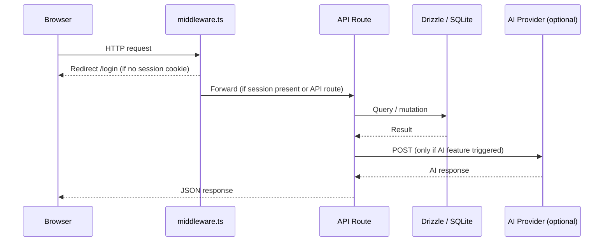
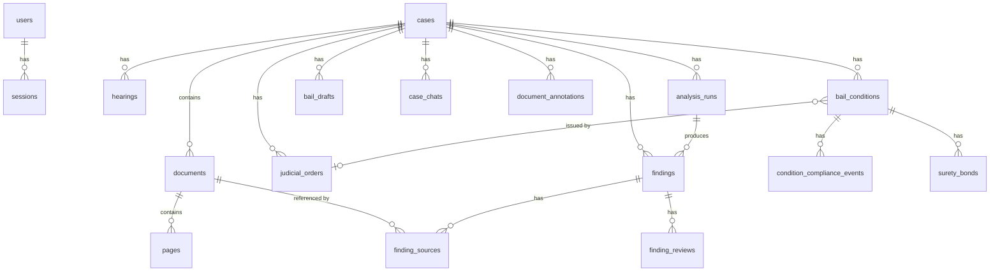
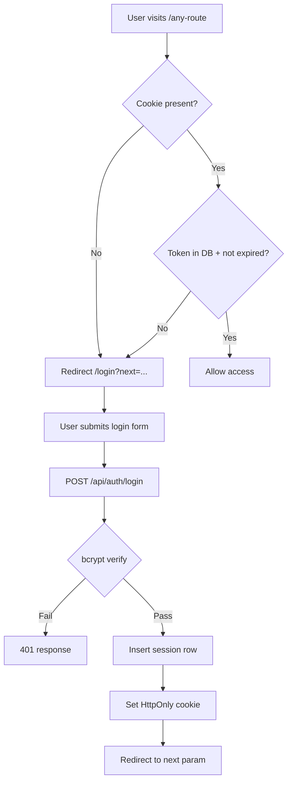
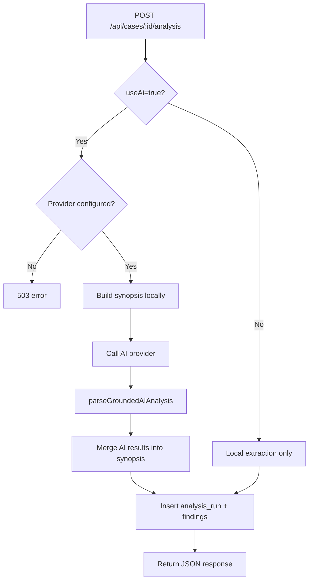
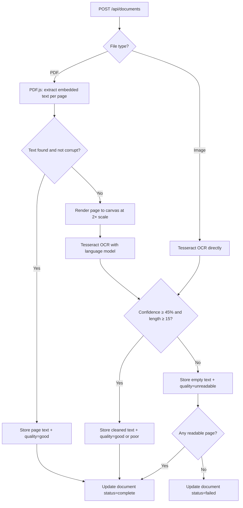
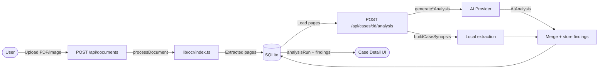

# Project Architecture

This document describes the architecture of NyayaTrace (NyayaSetu). For a quick overview, see [`README.md`](README.md). For AI agent instructions, see [`AGENTS.md`](AGENTS.md).

---

## Frontend Architecture

NyayaTrace uses the **Next.js 14 App Router** with React Server Components and client components as appropriate.

### Route Groups

```
app/
├── (app)/          ← Protected workspace (requires session cookie)
│   ├── layout.tsx  ← Shared layout: Sidebar + Topbar + MobileSidebar
│   ├── overview/   ← Dashboard: KPIs, recent cases, hearing chart
│   ├── cases/      ← Case list + case detail (analysis, docs, hearings, …)
│   ├── bail-briefs/← Bail brief view per case
│   ├── case-progress/ ← Timeline and activity per case
│   ├── concordance/ ← IPC ↔ BNS section concordance
│   ├── cause-list/ ← Court cause list board
│   ├── references/ ← Judges and advocates reference page
│   ├── reports/    ← Case report generation
│   ├── settings/   ← User settings
│   └── verification/ ← Document verification workspace
├── login/          ← Login page
├── signup/         ← Signup page
├── reset-password/ ← Password reset page
├── layout.tsx      ← Root layout (ThemeProvider, Toaster, fonts)
└── page.tsx        ← Root redirect (→ /login)
```

### Key Layout Components

| Component | File | Responsibility |
|---|---|---|
| `Sidebar` | `components/layout/Sidebar.tsx` | Navigation, user profile, logout |
| `Topbar` | `components/layout/Topbar.tsx` | Page title, search, mobile toggle |
| `AuthGuard` | `components/layout/AuthGuard.tsx` | Client-side redirect if session absent |
| `RouteThemeController` | `components/layout/RouteThemeController.tsx` | Per-route dark/light theme |
| `PageLoader` | `components/layout/PageLoader.tsx` | Spinner overlay during route transitions |
| `ThemeProvider` | `components/layout/ThemeProvider.tsx` | `next-themes` wrapper |

### Client vs Server Components

- **Server components** (default): page files (`page.tsx`), layout files, and most data-fetching wrappers. They can access the database directly via `lib/queries/` in Next.js server context.
- **Client components** (marked `'use client'`): anything that uses React hooks, browser APIs, animations, or interactive state. These include all components in `components/cases/`, `components/verification/`, and interactive tabs.

---

## Backend Architecture

All backend logic runs as **Next.js API Route Handlers** under `app/api/`. Every route exports `export const runtime = 'nodejs'` to ensure the Node.js runtime (required for `better-sqlite3`, Tesseract, and PDF.js).

```
app/api/
├── auth/           login, logout, me, signup, switch
├── cases/          CRUD + case sub-resources
│   └── [id]/
│       ├── analysis/      Run and retrieve case analysis
│       ├── bail-brief/    Bail brief data
│       ├── bail-draft/    Draft bail application generation
│       ├── brief/         Case brief data
│       ├── changelog/     Case changelog
│       ├── chat/          AI case chat (Gemini)
│       ├── chronology/    Hearing chronology
│       ├── conditions/    Bail conditions + compliance + surety
│       ├── detective-wall/ Detective investigation wall
│       ├── draft/         Draft generation
│       ├── legal-sections/ Auto-detect + extracted sections
│       ├── orders/        Judicial orders
│       ├── temporal-analysis/ Temporal contradiction detection
│       └── utp-relief/    Under-trial prisoner relief
├── annotations/    Document annotations
├── cause-list/     Cause list
├── documents/      Upload + serve document files
├── findings/       Discrepancy findings CRUD
├── hearings/       Hearings CRUD + chart data
├── legal-sections/ Section search + concordance
├── overview/       Dashboard stats
├── search/         Full-text search
├── system/health/  Health check
└── translate/      AI translation
```

### Request Flow



---

## Database Architecture

NyayaTrace uses a **single SQLite file** (`nyayatrace.db`) managed by Drizzle ORM. The schema is defined in [`lib/db/schema.ts`](lib/db/schema.ts) and migrations live in `drizzle/`.

See [`DATABASE_SCHEMA.md`](DATABASE_SCHEMA.md) for the full table reference.

### Entity Relationship Overview



---

## Authentication and Authorization Flow

NyayaTrace uses a **dual-layer auth** system:

### Layer 1: Server-side DB Sessions (`lib/auth-server.ts`)

1. User submits email + password to `POST /api/auth/login`.
2. Server hashes and compares with `bcryptjs`.
3. On success, a random token is inserted into the `sessions` table with a 7-day expiry.
4. Token is set as an **HttpOnly, SameSite=Lax** cookie named `nyayasetu_session`.
5. On subsequent requests, `middleware.ts` reads the cookie. If absent, the user is redirected to `/login?next=<original-path>`.
6. API routes call `getRequiredSession(request)` to validate the cookie token against the DB.

### Layer 2: Client localStorage (`lib/auth.ts`)

- The client-side session helper stores a minimal user record (`{ id, name, email, role }`) in `localStorage` for UI state (avatar, name display, sidebar).
- This does **not** gate any data access; it is purely for UI hydration.
- `signUpUser` in `lib/auth.ts` also writes to localStorage and does not hash or persist the password (used only for the client-side sign-up flow; real persistence goes through `POST /api/auth/signup`).

### Auth Flow Diagram



---

## AI Analysis Architecture

AI analysis is **optional and provider-agnostic**. All providers implement the same contract:

```typescript
// All AI provider functions share this signature
generateXxxAnalysis(documents: DocumentWithPages[], language: string): Promise<AIAnalysis>
```

`AIAnalysis` (defined in `lib/analysis/openai.ts`) includes: `metadataHeader`, `executiveSummary`, `factMatrix`, `verifiedCitations`, `documentSummaries`, `potentialInconsistencies`.

### Analysis Flow



### Local Extraction

Even without AI, `lib/analysis/synopsis.ts` extracts:
- Party names, dates, and locations using regex patterns in `lib/legalSanitizer.ts`
- Hearing chronology from `lib/analysis/chronology.ts`
- Legal section references from `lib/analysis/sectionExtractor.ts`
- Potential inconsistencies (date discrepancies, name variations, location mismatches)

---

## OCR Pipeline



Up to 10 PDF pages are processed in parallel (`MAX_PARALLEL_PAGES = 10` in `lib/ocr/index.ts`).

---

## Data Flow: Case Analysis



---

## Key Component Responsibilities

| Component | File | Responsibility |
|---|---|---|
| `VerificationWorkspace` | `components/verification/VerificationWorkspace.tsx` | Main document verification layout |
| `DocumentViewer` | `components/verification/DocumentViewer.tsx` | Render document pages with text overlay |
| `FindingsPanel` | `components/verification/FindingsPanel.tsx` | Display and manage discrepancy findings |
| `AnnotationsPanel` | `components/verification/AnnotationsPanel.tsx` | Create and manage page annotations |
| `CaseChatDrawer` | `components/verification/CaseChatDrawer.tsx` | AI case chat (Gemini) |
| `CaseDetailTabs` | `components/cases/CaseDetailTabs.tsx` | Tab switcher for case sub-sections |
| `AnalysisWorkspace` | `components/cases/tabs/AnalysisWorkspace.tsx` | AI analysis trigger and result view |
| `LegalSectionsTab` | `components/cases/tabs/LegalSectionsTab.tsx` | Legal section auto-detect and concordance |
| `BailBriefView` | `components/bail/BailBriefView.tsx` | Bail brief display with conditions, surety, timeline |
| `ConcordanceMatrix` | `components/legal/ConcordanceMatrix.tsx` | IPC ↔ BNS section concordance grid |
| `CaseBriefView` | `components/reports/CaseBriefView.tsx` | Printable case report + DOCX export |

---

## External Integrations

| Service | Purpose | Required? |
|---|---|---|
| Google Gemini API | AI case analysis, chat, translation | No (optional) |
| OpenAI API | AI case analysis, translation | No (optional) |
| Groq API | AI case analysis | No (optional) |
| OpenRouter | AI case analysis | No (optional) |
| Ollama (local) | AI case analysis (local LLM) | No (optional) |

All external calls originate from server-side API routes. No external service is called from the browser.
